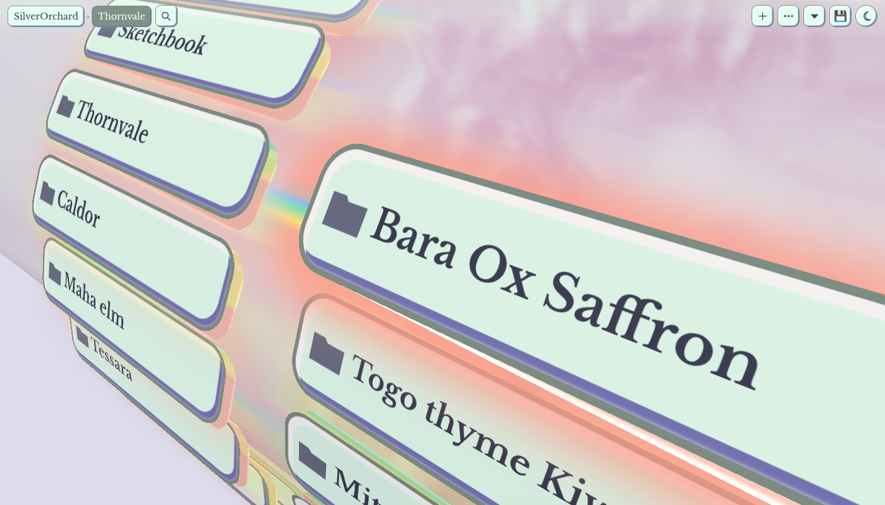
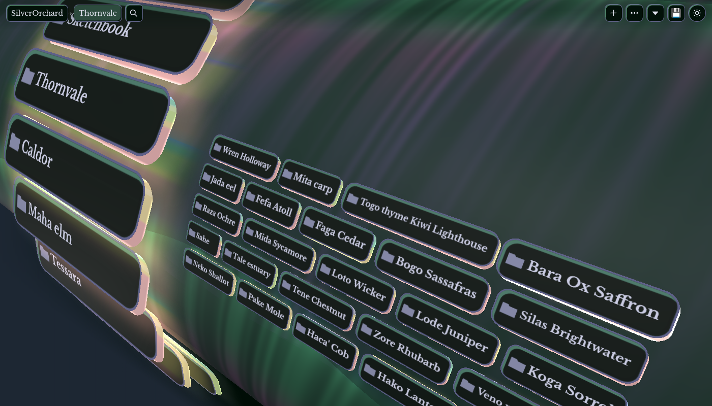
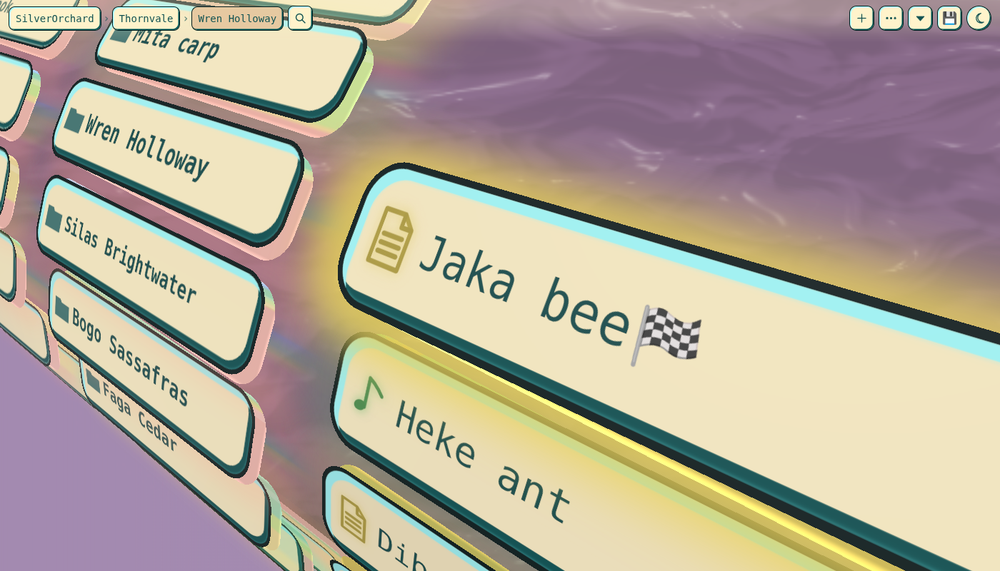
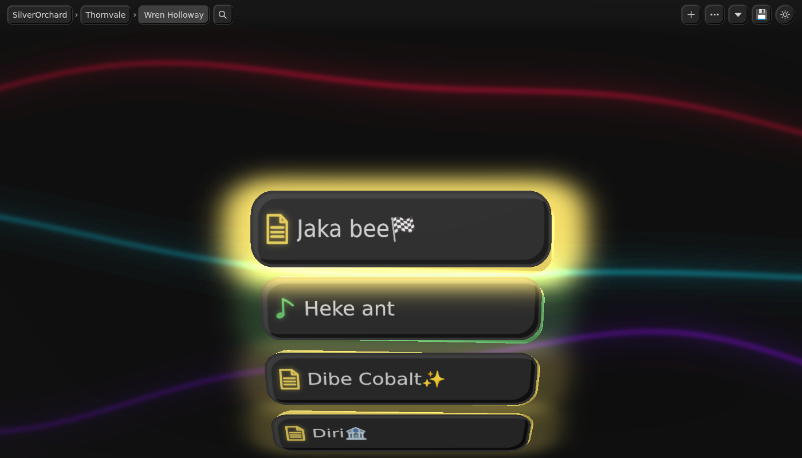

# VaultWheel

Browse your Obsidian vault as cards on a slowly turning cylinder. The folder you are in is a column of cards closest to you, and
its parents stand behind it. Pick files up into a stack, carry them anywhere, and spread them out on a board where you can arrange,
play, edit, move and trash them. Scale any folder from a list of cards up to a collage that fits it all on screen.

It is a file browser, not an editor for notes: a note opens in Obsidian as usual.










## Install

Get it from [its page in the Obsidian community directory](https://community.obsidian.md/plugins/vaultwheel) with **Add to Obsidian**. To install it by hand, download `main.js`, `manifest.json` and `styles.css` from a release into `.obsidian/plugins/vaultwheel/` in your vault,
then enable VaultWheel under Community plugins.

Open it from the disc icon in the ribbon, or the command **VaultWheel: Open the wheel**. It opens in a normal tab. Nothing else in
your layout moves, and it does nothing until you open it.

It needs Obsidian 1.8.7 or newer and WebGL (Settings, Appearance, Hardware acceleration on).

## What it does

- **The wheel**: click or tap a folder to go in, a file to bring it to the focus, the file in the focus to open it.
- **The stack**: Shift + click, Shift + Enter or a press and hold picks up a file or folder. It rides along while you move around.
- **The playground**: tap the stack to open a board of what you carry. Arrange, zoom, tidy, play songs and videos, read notes, then
  move or trash what you ticked.
- **Editors on the board**: crop and adjust pictures, edit sound (AudioMass) and video (Clip) right there. A save over the original
  keeps the old file in `.trash` first.
- **Scale and sort**: each folder has its own scale and sort, for this session or saved.
- **File jobs**: rename, duplicate, new file, new folder, cut, copy, paste, move to `.trash`, undo. Moves and renames go through
  Obsidian, so links are kept.
- **Themes**: the moon button goes round light, dark and the wheel's own themes. Two of them, Retroma and Willemstad, are named
  after Obsidian themes and follow those themes if you have them installed, otherwise they keep their built in colours.

## Keys

| Key | What |
|---|---|
| Arrows | Move along the column, in and out of folders |
| Page Up, Page Down, Home, End | Further along the column |
| Enter | Open what is in the focus |
| Shift + Enter | Pick it up |
| Backspace | Up a folder |
| Esc | Put everything back |
| Typing | Search the folder |
| F2 | Rename |
| Delete | Move to `.trash` (it asks first) |
| Ctrl/Cmd + D | Duplicate |
| Ctrl/Cmd + X, C, V | Cut, copy, paste |
| Ctrl/Cmd + Shift + N | New folder |
| Ctrl/Cmd + Z | Undo |
| Alt + scroll, or a pinch | Scale the folder |
| Ctrl/Cmd + click | Open a file from anywhere without moving |

Any other shortcut goes on to Obsidian, so Ctrl/Cmd + P and your own hotkeys work with the wheel in front. The plugin sets no
default hotkeys of its own. You can bind any of its commands under Settings, Hotkeys.

## Settings

| Setting | Default | What |
|---|---|---|
| Where the wheel lives | In a tab | In a tab, Left sidebar alone, Left sidebar under Properties, or Right sidebar. The left sidebar choices move that sidebar's other tabs to the right one; going back puts them back. On a computer, under Properties keeps File properties (showing at first), All properties, Backlinks and Outgoing links in a group above the wheel, and a core plugin that is off is skipped. That group is set up once: after that its tabs and height are yours, and a panel you close stays out of it until you choose this again (Obsidian itself may open some of them on the right at its next start). Per device |
| Right sidebar arrangement | Off | Computers only. Outline shows in the top group, the other tabs staying with it, and a file you choose stays open in a group below it, at about half the height. For a `.base` file you can name the view to show. Set up once: after that the tabs and heights are yours, and if you close the file it stays closed until this setting changes. Turned off, nothing moves back |
| Tablet layout on a phone | Off | Phones only. Holds Obsidian in its tablet layout on a phone screen. This is not an Obsidian feature, and a future version of Obsidian may stop it working. Per device |
| Hover takes the keyboard | On | The wheel takes the keyboard while the pointer is over it, and gives it back when the pointer leaves. Turned off, click the wheel first |
| Sound effects | Off | Small sounds as the wheel turns. Songs and videos you play are not affected |

Per device settings stay in this device's app storage, and the others go in the plugin's `data.json`, so they sync if your
`.obsidian` folder does.

## Privacy

- **Nothing leaves your device through this plugin on its own.** It has no telemetry, no account and no remote service. Its font and
  all its libraries are built into `main.js`.
- **A web picture in a note**: when you read a note on the board, a picture in it from the web loads from that site, the same as in
  Obsidian's reading view.
- **A web link in a note**: a click opens it in your browser.
- **The microphone**: the sound editor can record if you press its record button, and the system asks you first. A recording stays
  on your device until you save it to the vault.

## What it touches

- It reads your vault to show it, and writes to it only when you ask: every move, copy or trash asks first or can be undone, nothing
  is overwritten without a copy in `.trash`, and hidden folders such as `.obsidian` are out of its reach.
- It keeps its own files in `.obsidian/plugins/vaultwheel/`: `data.json` (settings and folder scales), `boards.json` (saved boards),
  and `theme-tokens.json`, only if you have Retroma or Willemstad installed. Uninstalling removes them.
- **Outside the vault, desktop only**: "Open with" in a card's menu hands the file to your system (the Open With chooser on Windows,
  Finder on a Mac, the default app on Linux). The file stays where it is. On desktop the plugin also reads the first bytes of pictures
  directly from disk to size their cards before they load. It asks for nothing outside the vault. On mobile neither of these exists.

## Known limits

- Turning the plugin off ends its view, as with any plugin's (Obsidian 1.15 leaves a tab that says so). If it has the left sidebar, choose **In a tab** first, so the tabs
  it moved go back. Tabs it did not move are never touched.
- Saved boards live in `boards.json` in the plugin's folder. A sync that only carries a plugin's usual files will not take them along.
- The theme and a few view choices are kept in the app's storage, which every vault on a device shares.
- The editors read a whole file into memory (up to 400 MB), which can be too much for a phone. Video export needs WebCodecs for an
  mp4 with sound; where that is missing the result is saved beside the original, not over it.
- A save over a file adds a copy to `.trash` each time. Empty it now and then.
- A copy is made under a hidden name and renamed when it is whole. If the app crashes or the power goes in the middle of one, a hidden `.vwcopy-...` file or folder can stay beside where the copy was going. The original is not touched, and the leftover can be deleted.
- The developer console shows one warning about the page's iframe sandbox: the page needs its own origin for its pictures and storage.
  What goes into it is cleaned first.
- Checked in the desktop app and in Obsidian's mobile emulation. Real phones and iOS have not all been tried yet.

## Licence

MIT, see [LICENSE](LICENSE).

Third party, all built into `main.js` with their licences at the end of that file, and listed in [vendor/NOTICE.md](vendor/NOTICE.md):

| What | Licence |
|---|---|
| [three.js](https://threejs.org) | MIT |
| [Cropper.js](https://github.com/fengyuanchen/cropperjs) | MIT |
| [AudioMass](https://github.com/pkalogiros/AudioMass) | MIT |
| [wavesurfer.js](https://github.com/katspaugh/wavesurfer.js) 2.0.5 and regions, in AudioMass | BSD-3-Clause |
| [lamejs](https://github.com/zhuker/lamejs), in AudioMass | LGPL-3.0 |
| LZ4 block codec, in AudioMass | BSD-2-Clause |
| [Clip](https://github.com/maarudth/clip) | MIT |
| [mp4-muxer](https://github.com/Vanilagy/mp4-muxer) | MIT |
| [gifenc](https://github.com/mattdesl/gifenc) | MIT |
| [Libre Baskerville](https://github.com/impallari/Libre-Baskerville) | SIL Open Font License 1.1 |

## What is in main.js

The store installs only `main.js`, `manifest.json` and `styles.css`, so `main.js` holds everything, in this order:

1. The plugin, which is `plugin/main.js` without its development parts.
2. The licences of everything built in, as one comment.
3. The page the wheel draws, as the string `VW_PAGE`. That is the page's HTML, CSS and JavaScript with its libraries and font inside, gzipped and then in base64 so the file stays small.

When a view opens, `unpackPage` in `main.js` turns that string back into the page with `atob` and gunzip and puts it in the view's iframe. Nothing is fetched to do this. Inside the page the editors' libraries are in base64 once more, and each is decoded the first time its editor opens.

To read the page, and to see it is what the source builds:

```sh
sed -n 's/^const VW_PAGE = "\(.*\)";$/\1/p' main.js | base64 -d | gunzip > page.html
sh tools/build.sh bridge built.html public && cmp page.html built.html
```

From 1.0.2 on, each release is built on GitHub from its tag by `.github/workflows/release.yml`, with an attestation for each file: `gh attestation verify main.js --repo Armachive/vaultwheel` checks one. `sh tools/release.sh` in a clean clone of the tag builds the same bytes.

### libflac.wasm

A scan of the plugin can report a reference to `src/libflac.wasm`. There is no such file here, and the plugin ships and runs no WebAssembly. The name comes from `vendor/audiomass/THIRD_PARTY_NOTICES.md`, the list [AudioMass](https://github.com/pkalogiros/AudioMass) keeps of the third party files in its own source, which is copied as it is into the licences in `main.js`.

In AudioMass that file is libFLAC 1.3.3 built for the browser, under the Xiph (New BSD) licence, and its FLAC export runs on it. `vendor/audiomass/` does not carry `flac.js`, `libflac.js` or `libflac.wasm`, so the sound editor here cannot export FLAC. It exports mp3 and wav. The `rnn_denoise.wasm` and `lz4-block-codec.wasm` on that list are not here either.

## Building it yourself

See [CONTRIBUTING.md](CONTRIBUTING.md) for how to build and test, and what a change must pass.

`tools/release.sh` makes the three files in `build/release/`: `plugin/main.js` with the page built in, gzipped and in base64 to keep
the file small. Change a library in `vendor/` and run it again to get a plugin with your copy.

- `src/`: the page (`vaultwheel.html`, `cards.js`, the playground). `tools/build.sh bridge <out> public` builds it alone. With nothing after `<out>`, the empty folder gifs and the editors' libraries go in `vaultwheel-gifs.json` and `vaultwheel-vendor.json` beside it, and the page asks for each the first time it wants it.
- `plugin/`: the plugin. The parts between `#if dev` lines are left out of a store build: they load a new `main.js` or page from the
  plugin folder as you work, show the **Reload on update** setting, and read what very old development builds left in the browser's storage.
- `tests/`: behaviour checks in headless Chromium, run with `tools/runall.sh`, and `tests/plugintest.js` for the plugin in node.
